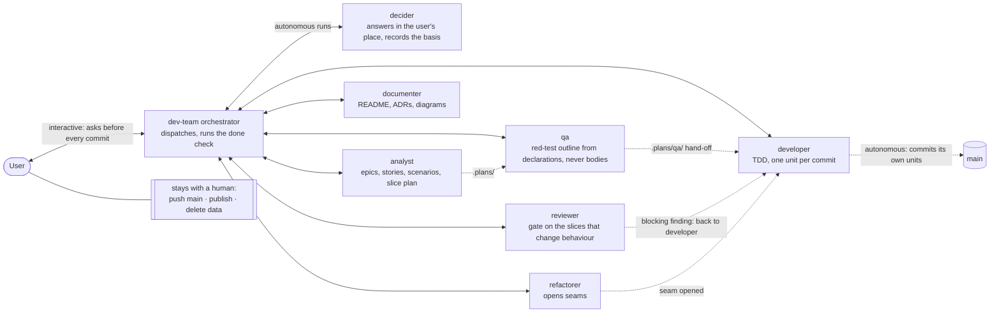
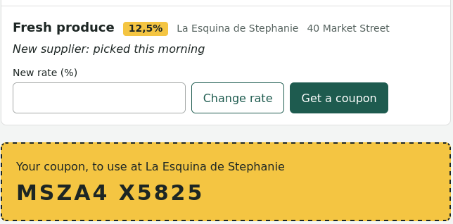
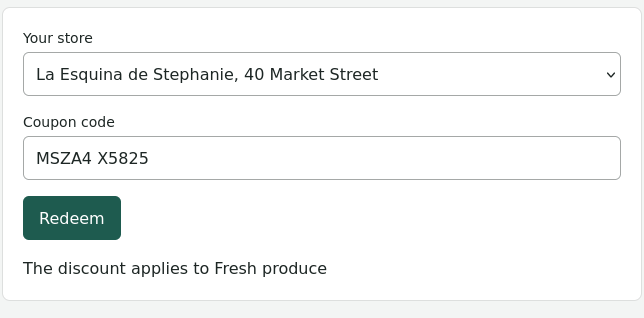
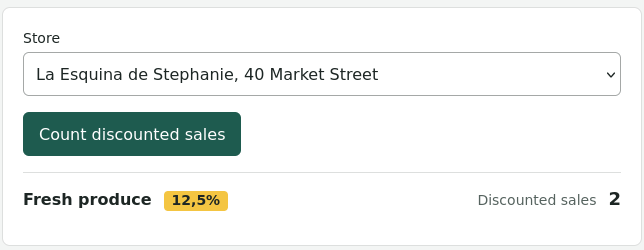

# Discounts: a working sample from Nicolás Straub's AI development team

Nico ([Nicolás Straub](https://github.com/nstraub)) is a software engineer with over 25 years of experience. He is the
architect of an AI development team: eight Claude Code agents (AI assistants that write and test code). Each agent has
one job, the way a human software team splits its work. He designed the team from published engineering knowledge,
meaning books and papers on how good software gets built. He tests it by preregistered experiment, where the plan is
fixed before the first trial so the results can't be bent to fit ([more](#the-architect-nicolás-straub)).

This repository holds what the team built: a web app that brings a neighbourhood's store discounts to the people who
shop there. The team built it test-first in TypeScript, so each behaviour starts as an automated check written before
the code that makes it work. The app is an internal benchmark, a job built to test the team, and it isn't a live
product. Its own full deployment pipeline (commit stage, deploy, acceptance stage) builds it, deploys it and tests it
end to end, from the web page to the database.

If you're deciding whether to hire Nico or license the team, this repository is the team's working sample. You don't
have to take his word for any of it: every step that wrote code or documents left a record here. Got five minutes? Read
one feature as the team wrote it down from Nico's own words, [Rodrigo counts](.plans/rodrigo-counts-epic.md). Then read
the list of tests one piece of work started from, [Stephanie redeems a
coupon](.plans/qa/_COMPLETE_slice-8-stephanie-redeems-a-coupon.md). Last, read one design decision, [ADR
0007](docs/adr/0007-one-change-at-a-time-to-a-discount-with-a-row-lock.md), and the commit that built it,
[`ebe5213`](https://github.com/nstraub/discounts/commit/ebe5213). To talk about hiring or licensing, see
[Contact](#contact); terms are explained in the [Glossary](#glossary).



## The app

Nobody signs up or logs in: a store is its name and its address, and everyone else is anonymous. That also means anyone
can act for any store. This is a deliberate choice, recorded with its alternative, a store key, in [ADR
0002](docs/adr/0002-anyone-can-act-for-any-store.md): a store key adds a credential to issue, keep and recover, which is
more scope than a benchmark needs. Like all unbuilt work on this page, it comes down to budget, and with unlimited usage
every gap, security included, would be closed.

- **Mike, a grocer known for his spices,** publishes a discount: the item, the rate, his store's name and address, and
  an optional hook that says why it is worth a look. He publishes at a rate above 0 % and at most 100 %, one decimal at
  most, point or comma, and raises or lowers it at any time (a new rate isn't checked yet; see [Better with every
  version](#better-with-every-version)); earlier discounts stay listed. If he leaves out a piece, nothing is published:
  the form names each missing piece beside its field.
- **Sue, who shops for better produce,** sees every discount from every store, with its hook, presses
  "Get a coupon" and gets a 10-character code to use at that store.
- **Stephanie, who runs another store nearby,** publishes her own discount and redeems coupons at the till: she picks
  her store, types the code and presses "Redeem". The till tells her the discount applies to the item, or that the
  coupon is already used, is for another store, or isn't valid. It reads codes forgivingly: case, spaces and dashes
  don't matter, O reads as 0, I and L as 1. Each coupon works once, even under simultaneous requests (a row lock, [ADR
  0007](docs/adr/0007-one-change-at-a-time-to-a-discount-with-a-row-lock.md), tested against a real database).
- **Rodrigo, who owns Stephanie's store and two more,** picks a store and counts the discounted sales of the store's
  discount since his last count.

| Sue: a discount and her coupon | Stephanie: the till | Rodrigo: the count |
|---|---|---|
|  |  |  |

Under the hood: NestJS and Drizzle over PostgreSQL, Vue 3 with Vite and Tailwind CSS, one Docker image serving the API
and the web app, and one deployment pipeline (`scripts/ci.sh`) that builds, deploys and acceptance-tests that image. The
app grew from an empty scaffold on this one stack; the team's mobile skills (Capacitor, Maestro), listed below, aren't
exercised here.

## Built by the dev-team (now at version 11)

The dev-team is the AI development team named at the top of this page: eight agents, one role each:

- `dev-team` (the orchestrator): the only role that talks to the user; it dispatches the others, runs the done check
  and, in interactive mode, makes every commit. It never writes code or tests itself.
- `analyst`: turns the user's own words into epics, stories, scenarios and a slice plan.
- `qa`: turns a slice's acceptance criteria into a red-test outline (`it.todo` lines named by behaviour), written from
  the code's declarations, never its implementation bodies; each hand-off lists what qa read.
- `developer`: writes each outlined test and the code that passes it, by TDD, one unit per cycle: red, green, refactor.
- `refactorer`: reshapes existing code, behaviour preserved, until the next test has a seam (a place to plug in) to land on.
- `reviewer`: the gate on the slices that change behaviour: it returns ranked findings against a checklist and never
  fixes them.
- `documenter`: keeps the README, ADRs and C4 and UML diagrams in step with the code.
- `decider`: stands in for the user in an autonomous run and records every decision with its basis.

How it works, in the order it happens:

1. A walking skeleton comes first: a thin slice from page to database is built, deployed and tested before any feature
   (Freeman & Pryce, [*Growing Object-Oriented Software, Guided by Tests*](https://growing-object-oriented-software.com/), *GOOS* for short).
2. Then each planned scenario becomes a slice: qa outlines the red tests, and the developer takes them green one unit at
   a time, one commit per unit.
3. Every slice that changes behaviour is reviewed once, and every slice is documented.
4. Every slice is deployable: a slice is done when it is green through the deployment pipeline (Humble & Farley, [*Continuous Delivery*](https://bookshop.org/p/books/continuous-delivery-reliable-software-releases-through-build-test-and-deployment-automation-david-farley/4124d4af52fe18eb?ean=9780321601919)).

When something goes wrong, the team has a set path:

- No seam for the next test: the refactorer opens one first.
- A blocking review finding: the slice goes back to the developer.
- A question with no precedent: the decider rules and records its basis, and a question only a persona can answer is
  held for the user.
- Nothing left that can move without the user: an autonomous run stops, as it does when its releases are green.

The dev-team runs in Claude Code: `claude --agent dev-team` starts a session with the orchestrator at its root, and each
of the other roles is a Claude Code subagent (the agent definitions themselves aren't part of this repository). It runs
three ways: interactive, where the orchestrator asks before every commit; autonomous in a worktree of its own; or
autonomous on `main`. In both autonomous modes the developer agent commits its own units. In every mode, pushing `main`,
publishing and deleting data stay with a human. The team brings its engineering rules with it, as skills; a project
gives it one file, [`AGENTS.md`](AGENTS.md), with what is specific to that project (its stack, commands, layout and
conventions), as this repository's does.

In this repository, the epics, stories, scenarios and slice plan came first, from an interactive session. Nico told
three epics and played Mike, Sue and Stephanie in interview; the orchestrator drafted Rodrigo's epic from Nico's
guideline, in his words, and Nico kept it. The orchestrator wrote the epics and stories from what Nico said (the analyst
role, which now does this, was added later), and Nico set the slices and releases. From there the team built the app in
one autonomous run on `main`, trunk-based, with no human approving each commit. Nico spoke only to the orchestrator; the
other roles ran autonomously, and the decider answered the team's questions in his place, except those only a persona
can answer, which were held for him.

The walking skeleton built the deployment pipeline itself, from a scaffold that had none: `scripts/ci.sh`, its GitHub
Actions workflow and the production image ([`ea78c66`](https://github.com/nstraub/discounts/commit/ea78c66)). Six slices
changed no behaviour: their scenarios passed as soon as their steps existed. The reviewer reviewed three of them; for
the other three, the passing tests were the review.

The team committed to `main` and never pushed it. Every commit after the initial scaffold carries Nico's git identity,
because the session is his, and a `Co-Authored-By: Claude Opus 5.5` trailer, because the code is Claude's: the team's,
except one later commit, the styling, made after the run by an agent outside the team; the foot of this page says why.

Every step that wrote code or documents left a record. In the repository: the epics, stories and slice plan in
[`.plans/`](.plans/), each slice's red-test hand-off in [`.plans/qa/`](.plans/qa/), the scenarios in
[`packages/sut/acceptance/features/`](packages/sut/acceptance/features/), the design decisions in
[`docs/adr/`](docs/adr/README.md), and one unit per commit in the history. With the team, outside this repository: the
reviewer's findings and the decider's rulings.

The history backs the process up. Commits record their own cycle in the body: the failing test's message under RED, what
made it pass under GREEN, the refactoring under REFACTOR
([`63b70c5`](https://github.com/nstraub/discounts/commit/63b70c5)); it also names the review finding it fixes (F1), as
[`0ca4ee8`](https://github.com/nstraub/discounts/commit/0ca4ee8) names F2. ADRs
[0001](docs/adr/0001-domain-events-through-a-port-with-an-eventemitter2-adapter.md),
[0002](docs/adr/0002-anyone-can-act-for-any-store.md),
[0005](docs/adr/0005-coupons-are-entities-inside-the-discount-aggregate.md) and
[0006](docs/adr/0006-one-transaction-per-discount-when-counting.md) name Nico as the one who decided: he set the rule
himself, or ratified the ruling the decider agent made on precedent during the run, when he reviewed its questions
afterwards. And the contract tests in [`packages/sut/contract/`](packages/sut/contract/) cover the hard cases: changes
to one discount at the same moment, every migration since the walking skeleton, run backward and forward again, and a
clean shutdown on SIGTERM.

## Engineering, applied to agents

Nico builds agent teams the way he builds software: the team's core roles and skills rest on published sources, and any
change to a team can be put through a preregistered experiment.

### Built on the literature

The sources:

- Freeman & Pryce, *GOOS*: test-first development and the walking skeleton
- Humble & Farley, *Continuous Delivery*: the deployment pipeline
- Dave Farley, [*Modern Software Engineering*](https://bookshop.org/p/books/modern-software-engineering-doing-what-works-to-build-better-software-faster-david-farley/1a44f2965ad2bb5c?ean=9780137314911): engineering as experiment and feedback
- Vaughn Vernon, [*Implementing Domain-Driven Design*](https://bookshop.org/p/books/implementing-domain-driven-design-vaughn-vernon/89d8ec524ab7ec6d?ean=9780321834577): aggregates and domain events
- [Martin Fowler](https://martinfowler.com) on refactoring, patterns and design; Dan North, [*Introducing BDD*](https://dannorth.net/blog/introducing-bdd/), on naming behaviour
- R. C. Martin, [*Design Principles and Design Patterns*](https://objectmentor.com/resources/articles/Principles_and_Patterns.pdf): the object-oriented design principles
- Anthropic, [*How we built our multi-agent research system*](https://www.anthropic.com/engineering/multi-agent-research-system): the orchestrator-and-specialists shape, run here one role at a time through files rather than in parallel

### Tested by preregistered experiment

A second agent team, the **lab**, can put any change to a team through a preregistered experiment. It is built like the
dev-team: an orchestrator, `lab`, that talks to the user, and four roles of its own (`lab-designer`, `lab-runner`,
`lab-analyst`, `lab-critic`), and it shares the dev-team's decider.

1. The plan is frozen before the first trial. Each hypothesis names the result that would refute it ([Popper](https://plato.stanford.edu/entries/popper/)); the plan is preregistered ([Nosek et al., PNAS 2018](https://pmc.ncbi.nlm.nih.gov/articles/PMC5856500/)) and sized in advance by a power analysis (how many trials it takes to detect the smallest effect worth acting on).
2. Trials are isolated. Every trial gets its own home, configuration and repository; the runner never sees the hypotheses, and a failed trial is recorded as a failure.
3. A blind, calibrated judge grades one criterion at a time on redacted, shuffled outputs. It grades nothing until its grades agree with human grades on a reference set, a calibration gate ([Anthropic, *Demystifying evals for AI agents*](https://www.anthropic.com/engineering/demystifying-evals-for-ai-agents)).
4. Only the planned statistics are computed. Anything else is labelled exploratory.
5. An independent critic who didn't design, run or analyse the experiment reviews every claim.

**This project is the subject of a lab experiment.** Its plan builds the same releases three ways: by a plain session, by a session with the skills only, and by the dev-team, each with and without automated [habit-hooks](https://github.com/habit-hooks/habit-hooks). Scripts and a calibrated blind judge grade each arm on function, process, unit tests, SOLID design, the domain model and the rules it was given. The code in this repository was built by the dev-team with habit-hooks enabled, the setting of one of the plan's arms: a benchmark run, not one of its isolated trials.

## The architect: Nicolás Straub

Nico is the architect of the two agent teams behind this repository: the dev-team that built the app and the lab that
tests the dev-team. He is a software engineer with deep expertise in test-driven development, domain-driven design,
refactoring, SOLID and object-oriented design, and a hands-on practitioner in TypeScript, Node, Vue and PostgreSQL.
Working with him, you notice:

- **Evidence over assertion.** He runs the check before he trusts the claim, and builds the same into his teams: see
  the lab's calibrated judge above.
- **Sources over opinions, his own included.** He expects a rule he gives an agent to cite its published source, and to
  be challenged until it does: most rows in the "Why built in-house" columns below name theirs.
- **Corrections welcome, in both directions.** He says plainly when something is wrong, and changes course when he is.
- **Collaboration, not command.** Work goes to whichever side does it cheaper: an agent asks him for a missing log or an
  unclear intent rather than guessing (in an autonomous run, the decider answers in his place), because answering costs
  him seconds and guessing can cost the run.
- **Precision.** He says exactly what he means, and expects the same back.
- **Disciplined process.** Small units, one commit each, and nothing reported done until it is verified. He builds that
  discipline into his teams: the dev-team's [commit history](https://github.com/nstraub/discounts/commits/main) is one
  unit per commit.
- **Clear boundaries.** He decides what agents do on their own and what stays with a human: pushing `main`, publishing,
  deleting data.

Hire Nico and you get an engineer who has spent fifteen years refining his own engineering process, drawing on the
sources above among others, and who turns that knowledge into working agents and can show the source behind a rule.
License the dev-team and you get test-first delivery through a deployment pipeline.

## Better with every version

The dev-team carries a version number, and runs feed the next version: what a run shows becomes a change to an agent
or, most often, a skill.

Four skills were revised from observed runs: `tdd`, `refactoring`, `naming-tests-by-behaviour` and
`applying-design-patterns`. They and seven more, `writing-unit-tests`, `committing-one-unit-per-commit`,
`writing-readable-code`, `srp`, `edge-case-discovery`, `api-testing` and `database-testing`, have been through skill
tests (evals that compare an agent's output with and without the skill) and were checked against published sources.

This repository is a work in progress. This run was the first in which the dev-team wrote its own epics, stories and
acceptance criteria (with Nico, interactively) and modelled the domain with DDD. An experienced reader will find code
that doesn't yet follow DDD strictly and slices that depend on one another, and will see that the reviewer's scope was
unclear during the run: it reviewed three of the six slices that changed no behaviour and not the others. Those
findings, with the epics, stories, acceptance criteria and code this run produced, are the material the next refinement
works from: domain modelling (`modelling-the-domain`), stories and epics (`writing-user-stories`,
`choosing-which-stories-to-solve`, `interviewing-a-persona`), acceptance criteria (`writing-acceptance-criteria`) and
slicing (`walking-skeleton-and-vertical-slices`).

Seven of the slice plan's twelve releases are built: the walking skeleton and seventeen slices, with ten design
decisions recorded as ADRs in [`docs/adr/`](docs/adr/README.md). The other five releases, slices 18 to 26, are already
specified, their scenarios written in the epic files, and qa outlines each slice's red tests when the slice starts.

What isn't built yet is recorded in the repository: the `@todo` scenarios and `it.todo` lines, counting each of a
store's discounts on its own, and checking a rate when it is changed as well as when it is published. Most `@todo`
scenarios are edge cases the team found and recorded as it went, outside the slice plan: a map of what to harden next.
Budget is the only thing between that list and working code, since the scenarios the team builds from already exist, so
whoever funds the next increment knows what it buys.

## Known bugs

- The publish form clears every field after a refused publish, so Mike has to type everything again.
  The qa agent had recorded keeping what he typed as out of scope (slices 14 and 16); seen in use, it is a bug.

Each bug a run finds goes into the debrief for the next version of the dev-team and becomes a change to the agent or
skill that let it through.

## What the teams are made of

Nico's rule is search first. Where an existing agent or skill does the job, it is adopted (the *curated* tables below),
and adapted to the team's rules where marked. Where the search turns up only near misses, the part is homebrewed (the
*homebrewed* tables): written in-house from what Nico teaches and the published sources it cites, then meticulously
groomed and refined, iteration by iteration, as evidence comes in. Both teams are listed below: the dev-team (**dev**)
and the lab (**lab**).

### Curated agents

None adopted whole. Three lab roles take their stance from a published agent and add the rest in-house; they are
listed below.

### Homebrewed agents

<details><summary>13 homebrewed agents</summary>

| Agent | Team | Version | Why built in-house |
|---|---|---|---|
| `dev-team` | dev | 11 | Orchestrates seven roles, talks to the user and makes the commits in interactive mode; designed around test-first delivery and Humble & Farley's deployment pipeline. |
| `analyst` | dev | 1 | Turns the user's own words into epics, stories, scenarios and slice plans; the search found only Gherkin reviewers and slicers, none that writes them. |
| `qa` | dev | 1 | Writes red-test outlines blind to the implementation; the search found test-quality reviewers, nothing enforcing a one-spec-per-method outline. |
| `developer` | dev | 2 | RED, GREEN, REFACTOR, one unit per cycle, ops and toolchain included; the TDD-cycle tools found were trial-grade, so the role is composed in-house on GOOS. |
| `refactorer` | dev | 1 | The search found no agent that walks a smell catalogue against a diff and names the technique per smell; built on the house refactoring skills. |
| `reviewer` | dev | 1 | One review per slice that changes behaviour, against a TDD-adherence checklist; the search found nothing that audits the refactor step or test-first per behaviour. |
| `documenter` | dev | 1 | Keeps README, ADRs, C4 and UML in step with the code, one document per unit, routing to curated documentation skills; near misses were single-purpose ADR or drift tools. |
| `decider` | dev + lab | 3 | Decides in the user's place in autonomous runs and records each decision with its basis, so precedent answers the next question. |
| `lab` | lab | 3 | Orchestrates preregistered experiments; the team design follows Anthropic's multi-agent research system. |
| `lab-designer` | lab | 1 | Writes the plan; stance from agency-agents' [Statistician](https://github.com/msitarzewski/agency-agents/blob/main/academic/academic-statistician.md), plus hypotheses that name their refuting result, the LLM judge's rubric and calibration set, and a refusal to size on observed data. |
| `lab-runner` | lab | 1 | Runs isolated trials and the calibrated judge, following Anthropic's *Demystifying evals for AI agents* and Nosek et al. on reporting deviations. |
| `lab-analyst` | lab | 1 | Computes the planned statistics; stance from agency-agents' [Statistician](https://github.com/msitarzewski/agency-agents/blob/main/academic/academic-statistician.md), plus a frozen plan it never edits, the task as the unit, and pass@k kept apart from pass^k. |
| `lab-critic` | lab | 1 | Reviews every claim; stance from agency-agents' [Statistician](https://github.com/msitarzewski/agency-agents/blob/main/academic/academic-statistician.md), plus an eval-claims checklist, a check of the judge calibration behind every graded result, and no edits, even when asked. |

</details>

### Curated skills

"Adapted" means the published skill was taken as the base and fitted to the house rules.

<details><summary>30 curated skills</summary>

| Skill | Team | What it does | Source |
|---|---|---|---|
| `edge-case-discovery` | dev | Boundaries and state combinations acceptance criteria leave implicit | [Notysoty/openagentskills](https://github.com/Notysoty/openagentskills/tree/main/skills/edge-case-discovery) (adapted) |
| `adversarial-testing` | dev | Abuse cases: injection, races, stolen handles, rule cheating | [KieranHoward646/Adversarial-Testing-Skill](https://github.com/KieranHoward646/Adversarial-Testing-Skill) (adapted) |
| `api-testing` | dev | Endpoint status, body, schema and validation test lines | [petrkindlmann/qa-skills](https://github.com/petrkindlmann/qa-skills/tree/main/skills/api-testing) (adapted) |
| `database-testing` | dev | Repository round-trips, constraints and migration test lines | [petrkindlmann/qa-skills](https://github.com/petrkindlmann/qa-skills/tree/main/skills/database-testing) (adapted) |
| `exploratory-testing` | dev | Time-boxed charter sessions probing a slice's surface | [petrkindlmann/qa-skills](https://github.com/petrkindlmann/qa-skills/tree/main/skills/exploratory-testing) (adapted) |
| `pact-contract-testing` | dev | Pact contracts between independently released services | [petrkindlmann/qa-skills](https://github.com/petrkindlmann/qa-skills/tree/main/skills/contract-testing) (adapted) |
| `maestro-mobile` | dev | Black-box mobile UI flows with Maestro | [PramodDutta/qaskills](https://github.com/PramodDutta/qaskills/tree/main/seed-skills/maestro-mobile) (adapted) |
| `mutation-testing` | dev | Turns surviving mutants into red tests | [secondsky/claude-skills](https://github.com/secondsky/claude-skills/tree/main/plugins/mutation-testing/skills/mutation-testing) (adapted) |
| `property-based-testing` | dev | Property tests for round-trips, parsers and invariants | [trailofbits/skills](https://github.com/trailofbits/skills/tree/main/plugins/property-based-testing/skills/property-based-testing) (adapted) |
| `capacitor-app-development` | dev | Capacitor concepts, CLI, configuration and platforms | [capawesome-team/skills](https://github.com/capawesome-team/skills/tree/main/skills/capacitor-app-development) (adapted) |
| `capacitor-vue` | dev | Vue 3 patterns for Capacitor plugins | [capawesome-team/skills](https://github.com/capawesome-team/skills/tree/main/skills/capacitor-vue) (adapted) |
| `capacitor-app-store` | dev | Publishing Capacitor apps to the App Store and Google Play | [Cap-go/capgo-skills](https://github.com/Cap-go/capgo-skills/tree/main/skills/capacitor-app-store) (adapted) |
| `capacitor-ci-cd` | dev | CI/CD pipelines for Capacitor builds and signing | [Cap-go/capgo-skills](https://github.com/Cap-go/capgo-skills/tree/main/skills/capacitor-ci-cd) (adapted) |
| `database-migrations` | dev | Schema and data migrations, rollbacks, zero downtime | [affaan-m/ECC](https://github.com/affaan-m/ECC/tree/main/skills/database-migrations) (adapted) |
| `docker-patterns` | dev | Dockerfiles, Compose, container security and networking | [affaan-m/ECC](https://github.com/affaan-m/ECC/tree/main/skills/docker-patterns) (adapted) |
| `search-first` | dev | Looks for existing solutions before writing or installing | [affaan-m/ECC](https://github.com/affaan-m/ECC/tree/main/skills/search-first) (adapted) |
| `architecture-decision-records` | dev | Captures decisions as structured ADRs | [affaan-m/ECC](https://github.com/affaan-m/ECC/tree/main/skills/architecture-decision-records) (adapted) |
| `living-docs-governance` | dev | Keeps long-lived documentation from drifting | [affaan-m/ECC](https://github.com/affaan-m/ECC/tree/main/skills/living-docs-governance) |
| `nestjs-documentation` | dev | Swagger/OpenAPI and response schemas in NestJS | [HoangNguyen0403/agent-skills-standard](https://github.com/HoangNguyen0403/agent-skills-standard/tree/main/skills/nestjs/nestjs-documentation) |
| `postgresql-table-design` | dev | PostgreSQL schema design, types, indexes, constraints | [wshobson/agents](https://github.com/wshobson/agents/tree/main/plugins/database-design/skills/postgresql-table-design) |
| `supabase-postgres-best-practices` | dev | Postgres rules for schema, security and performance | [supabase/agent-skills](https://github.com/supabase/agent-skills/tree/main/skills/supabase-postgres-best-practices) |
| `c4-model` | dev | Co-builds C4 architecture diagrams | [cheriftj/c4-model-skill](https://github.com/cheriftj/c4-model-skill/tree/main/skills/c4-model) |
| `slim-readme` | dev | README template | [NASA-AMMOS/slim](https://github.com/NASA-AMMOS/slim/tree/main/static/marketplace/skills/slim-readme) (adapted) |
| `experimental-design` | lab | Randomisation, blocking, factorial layouts | [K-Dense-AI/scientific-agent-skills](https://github.com/K-Dense-AI/scientific-agent-skills/tree/main/skills/experimental-design) |
| `hypothesis-generation` | lab | Testable hypotheses and preregistration-ready plans | [K-Dense-AI/scientific-agent-skills](https://github.com/K-Dense-AI/scientific-agent-skills/tree/main/skills/hypothesis-generation) |
| `statistical-power` | lab | Sample size, power, minimum detectable effect | [K-Dense-AI/scientific-agent-skills](https://github.com/K-Dense-AI/scientific-agent-skills/tree/main/skills/statistical-power) (adapted) |
| `scientific-critical-thinking` | lab | Evaluates claims, bias and evidence quality | [K-Dense-AI/scientific-agent-skills](https://github.com/K-Dense-AI/scientific-agent-skills/tree/main/skills/scientific-critical-thinking) (adapted) |
| `brainstorming` | dev | Explores intent and design before building | [obra/superpowers](https://github.com/obra/superpowers/tree/main/skills/brainstorming) |
| `dispatching-parallel-agents` | dev | Runs independent tasks in parallel | [obra/superpowers](https://github.com/obra/superpowers/tree/main/skills/dispatching-parallel-agents) |
| `systematic-debugging` | dev | Finds the root cause before fixing | [obra/superpowers](https://github.com/obra/superpowers/tree/main/skills/systematic-debugging) |

</details>

### Homebrewed skills

<details><summary>33 homebrewed skills</summary>

| Skill | Team | Revision | Why built in-house |
|---|---|---|---|
| `collaborating-with-the-user` | dev + lab | rev 47, 2026-10-02 | Encodes the house rules for working with the user; the closest external match was considered and not adopted. |
| `committing-one-unit-per-commit` | dev + lab | rev 22, 2026-10-05 | One unit per commit, after GOOS, Farley's *Modern Software Engineering* and *Continuous Delivery*. |
| `working-autonomously` | dev | rev 10, 2026-10-05 | Autonomous runs on `main` by default: trunk-based development, *Continuous Delivery*'s develop-on-mainline practice. |
| `definition-of-done` | dev | rev 4, 2026-10-05 | "Done means released", from *Continuous Delivery*, and Fowler's Keystone Interface. |
| `tdd` | dev | rev 21, 2026-09-30 | The house TDD procedure at every test level, per GOOS, *Continuous Delivery* and Fowler. |
| `walking-skeleton-and-vertical-slices` | dev | rev 15, 2026-10-03 | Walking skeleton and slicing from GOOS and [Cockburn](https://web.archive.org/web/20140329201356/http://alistair.cockburn.us/Walking+skeleton); the slicers found in the search were trial-grade. |
| `writing-acceptance-criteria` | dev | rev 14, 2026-10-03 | Grounded in GOOS and *Continuous Delivery*; the search found reviewers of criteria, but no author of intent-named scenarios. |
| `writing-user-stories` | dev | rev 3, 2026-09-30 | Taught by Nico rule by rule; cites Farley's *Modern Software Engineering*. |
| `choosing-which-stories-to-solve` | dev | rev 2, 2026-09-30 | Taught by Nico rule by rule: which stories the software solves, which stay told. |
| `interviewing-a-persona` | dev | rev 1, 2026-09-29 | Taught by Nico rule by rule: interviewing a user, or a stand-in, before writing an epic. |
| `handing-off-red-tests` | dev | rev 9, 2026-09-29 | The qa hand-off contract: red tests outlined blind to the implementation, per the house rule that QA never sees implementation bodies. |
| `naming-tests-by-behaviour` | dev | rev 5, 2026-09-30 | Test names as behaviour sentences, per GOOS. |
| `contract-testing` | dev | rev 8, 2026-09-30 | The unit/contract split, per GOOS's focused integration tests and *Continuous Delivery*. |
| `writing-unit-tests` | dev | rev 11, 2026-09-30 | House unit-test conventions from GOOS, *Continuous Delivery* and Fowler; the search found reviewers, nothing encoding these conventions. |
| `sizing-units-of-code` | dev | rev 9, 2026-09-30 | How big one TDD unit is, per GOOS. |
| `refactoring` | dev | rev 11, 2026-09-30 | Techniques indexed to the refactoring catalogue and backed by GOOS; the reviewers found in the search were trial-grade. |
| `code-smells` | dev | rev 4, 2026-09-30 | A smell index plus a rule for walking it at every REFACTOR step; the nearest catalogue match was trial-grade. |
| `writing-readable-code` | dev | rev 13, 2026-09-30 | Code that reads fast, not code written fast: the house rule, after GOOS and *Modern Software Engineering*. |
| `srp` | dev | rev 6, 2026-09-30 | Single responsibility from R. C. Martin's [chapter](https://objectmentor.com/resources/articles/srp.pdf), backed by GOOS. |
| `modelling-the-domain` | dev | rev 8, 2026-10-05 | Tactical DDD rules from Vernon's *Implementing Domain-Driven Design* (aggregates, ch. 10) and Fowler; the search found no agent checking them. |
| `applying-architectural-patterns` | dev | rev 6, 2026-09-30 | Ports and adapters and placement rules from GOOS, Vernon, Fowler and *Continuous Delivery*. |
| `applying-design-patterns` | dev | rev 8, 2026-09-30 | Pattern choice and naming, after GOOS and Fowler. |
| `tell-dont-ask` | dev | rev 7, 2026-09-30 | Tell, don't ask, per GOOS and Fowler. |
| `oop-principles` | dev | rev 5, 2026-09-30 | Routes to the OOP and SOLID skills, after GOOS. |
| `ocp` | dev | rev 1, 2026-09-25 | Open/closed principle after R. C. Martin's [article](https://objectmentor.com/resources/articles/ocp.pdf). |
| `lsp` | dev | rev 1, 2026-09-25 | Liskov substitution after R. C. Martin's [article](https://objectmentor.com/resources/articles/lsp.pdf). |
| `isp` | dev | rev 2, 2026-09-30 | Interface segregation after R. C. Martin's [article](https://objectmentor.com/resources/articles/isp.pdf), with GOOS and Fowler. |
| `dip` | dev | rev 3, 2026-09-30 | Dependency inversion after R. C. Martin's [article](https://objectmentor.com/resources/articles/dip.pdf), with GOOS and Fowler. |
| `using-feature-flags` | dev | rev 3, 2026-09-30 | Feature toggles per Hodgson's [article](https://martinfowler.com/articles/feature-toggles.html) on martinfowler.com and *Continuous Delivery*. |
| `diagramming-designs` | dev | rev 3, 2026-09-29 | House Mermaid and UML rules for showing designs. |
| `grading-with-a-calibrated-judge` | lab | rev 1, 2026-10-03 | The reuse search's verdict was "write new"; built on Anthropic's *Demystifying evals for AI agents*. |
| `analyzing-eval-results` | lab | rev 1, 2026-10-04 | The reuse search named eval statistics a gap to fill; the near misses were not adopted. |
| `reviewing-eval-claims` | lab | rev 1, 2026-10-04 | The reuse search found only general critique skills; this is an eval-specific claims checklist drawn from the lab's vetted sources. |

</details>

<sub>Agent versions are the definition's own version number; skill revisions count the commits to the skill file, as of 2026-10-06.</sub>

## Run it yourself

You need Node 26.9.0 and Docker. Clone the repository and run the one setup command from its root:

```bash
git clone https://github.com/nstraub/discounts.git
cd discounts
./scripts/bootstrap.sh
```

It installs Corepack if Node lacks it, enables Yarn 4, runs `yarn install` (env files, git hooks, the Playwright
browser), and starts a fresh PostgreSQL 16. Run it again any time you want empty local databases. Then apply the
migrations and start the app:

```bash
yarn db:migrate
yarn dev
```

There's no sign-in, so each screen lists what the database holds and is opened by its address: Mike, Sue and Stephanie
share the discounts page at `http://localhost:5173/#/`, Stephanie's till is at `http://localhost:5173/#/till` and
Rodrigo's count at `http://localhost:5173/#/count`. The budget left out a login and a page per person.

| Command | What it does |
|---|---|
| `yarn dev` | Backend on port 3000, web app on port 5173 |
| `yarn test` | Unit tests |
| `yarn test:contract` | Contract tests against a real database (Linux only: needs `unshare`, `pgrep` and unprivileged user namespaces) |
| `yarn test:bdd` | Cucumber acceptance scenarios, except those tagged `@wip` or `@todo` |
| `yarn test:wip` | The scenarios tagged `@wip` |
| `yarn test:skeleton` | The walking-skeleton test against the deployed app (needs `DEPLOYED_APP_URL`) |
| `yarn build` | Builds every workspace |
| `yarn db:migrate` | Applies pending migrations |
| `scripts/ci.sh` | The whole deployment pipeline |

`scripts/ci.sh` is wired to GitHub Actions for every push and pull request, and runs the same way on your machine. It
builds, lints and runs the unit and contract tests, deploys the production image with its own PostgreSQL and applies the
migrations, then runs the walking-skeleton test and the Cucumber scenarios against the deployed app. There's no public
deployment: the pipeline deploys to your machine or the CI runner.

PostgreSQL listens on `POSTGRES_HOST_PORT` (default 5432) and the deployed app on `http://127.0.0.1:8080` (set
`APP_HOST_PORT` in a root `.env` to change it). The deployed app's data lives in the `production-data` volume and is
migrated on every deploy. [`docs/architecture.md`](docs/architecture.md) draws the system in Mermaid: a C4 container
diagram of the deployed app, a C4 component diagram of the discounts context, sequence diagrams of the main requests
(publishing a discount, changing its rate, getting a coupon, redeeming it, counting the discounted sales) and the
deployment pipeline. How the code is laid out, and the project's own working rules, are in [`AGENTS.md`](AGENTS.md).

## Licence

Copyright © 2026 Nicolás Straub. This repository's code is free software under the GNU General Public License,
version 3 only (SPDX `GPL-3.0-only`); see [`LICENSE.md`](LICENSE.md). It comes with no warranty. The dev-team itself
isn't part of this repository.

## Contact

To hire Nico, or to license the dev-team, write to **[agents@idem.social](mailto:agents@idem.social)**. Nico is the CEO
and CTO of idem, software consultants.

## Glossary

| Term | Meaning |
|---|---|
| Acceptance criteria | A slice's Gherkin scenarios, fixed before its tests are outlined. |
| ADR | Architecture decision record: one short file per design decision, with its context and the alternatives weighed ([`docs/adr/`](docs/adr/README.md)). |
| Agent | A Claude Code agent: one role with its own instructions and tools. The orchestrator runs as the session itself; the other roles run as its subagents. |
| Arm | One of the setups an experiment compares. |
| C4 | A way of drawing a system at four zoom levels: context, containers, components and code. |
| Contract test | A test of the wired application against a real PostgreSQL database, through its HTTP endpoints ([`packages/sut/contract/`](packages/sut/contract/)). |
| Curated | An agent or skill adopted from a published source, adapted to the team's rules where marked. |
| DDD | Domain-driven design: the code is shaped around the business's own concepts (here, a discount and its coupons). |
| Debrief | The team's record of what a run showed, kept outside this repository, for the next version. |
| Done check | The orchestrator's last step for a slice: green through the deployment pipeline before the slice is reported done. |
| Epic | One person's story told whole, broken down into stories. |
| Gherkin scenario | A plain-language example of one behaviour ("Given … When … Then …") that also runs as an acceptance test. |
| habit-hooks | A separate tool the team runs before it considers work complete; whatever it reports is dealt with first ([habit-hooks](https://github.com/habit-hooks/habit-hooks), [`AGENTS.md`](AGENTS.md)). |
| Homebrewed | An agent or skill written in-house, because the search found only near misses. |
| Keystone Interface | Fowler's practice of building a feature behind the scenes and adding the part users reach last, so unfinished work can ship dark. |
| Orchestrator | The dev-team's lead agent: the only one that talks to the user; it hands work to the other roles. |
| pass@k / pass^k | Whether at least one of k tries passes, and whether all k pass. |
| Persona | One of the people the app serves (Mike, Sue, Stephanie, Rodrigo); the user answers in their place. |
| Preregistered experiment | An experiment whose plan, hypotheses and analysis are frozen before the first trial runs. |
| Red test | A test written before the code it checks, so it fails until that code exists. |
| Release | A point in the slice plan where someone the app serves sees something new; planned, not shipped separately. |
| Run | One stretch of autonomous work by the team, from its first slice to where it stopped. |
| Seam | A place where a test can plug in without editing the code around it. |
| Skill | A file of working instructions an agent loads when a task calls for it; the team's rules live in skills. |
| Slice | One thin, end-to-end piece of the plan, usually one behaviour, built and deployed on its own. |
| Slice plan | The ordered list of slices and the releases they add up to ([`.plans/`](.plans/)). |
| Story | One thing a person wants from the app, written from their side; its scenarios say when it is done. |
| TDD | Test-driven development: red (a failing test), green (the least code that passes it), refactor. |
| `@todo` / `it.todo` | An acceptance scenario, or a unit test, written down but not yet built. |
| Trunk-based | Every commit goes straight onto the main branch; no long-lived branches. |
| Unit | The smallest step of TDD: one failing test made to pass, committed on its own. |
| Walking skeleton | The thinnest end-to-end slice, from page to database, built, deployed and tested before any feature. |
| Worktree | A separate checkout of the same repository, for work kept apart from the main one. |

<sub>The screens were styled after the run, in one commit
([f9f223e](https://github.com/nstraub/discounts/commit/f9f223e)) by a designer agent outside the dev-team, and the design
is recorded in [`docs/design.md`](docs/design.md). The house definition of done counts styling as part of the work, and
this run left it out: that gap is in the debrief for the next version.</sub>

<sub>This README was written by agents, interactively, under Nico's direction.</sub>

<sub>Claude and Claude Code are trademarks of Anthropic; other names belong to their owners. Neither Anthropic nor the authors of the sources, agents, skills and tools credited here are affiliated with, or endorse, this project or the dev-team.</sub>
