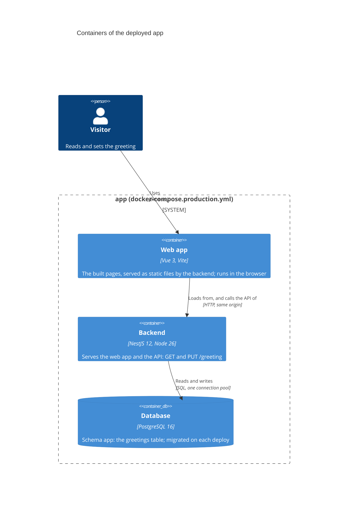
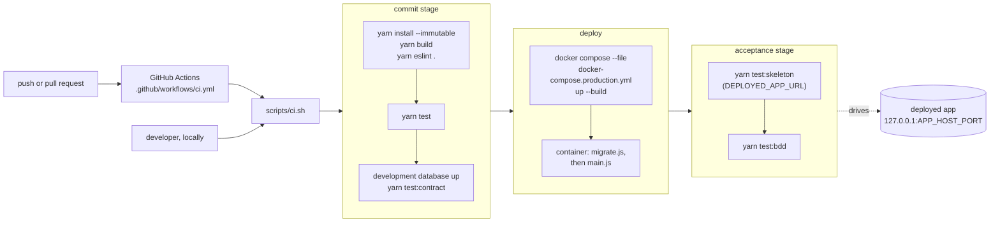

# Architecture: containers and deployment

A C4 container diagram of the walking skeleton, and the pipeline that deploys it.

## Containers

The backend is one process: it serves the built web app (static files) and the API. The browser loads
the page from it, and the page calls the API on the same origin. The backend reads and writes
Postgres.

Port 3000 inside the container is published on `127.0.0.1:${APP_HOST_PORT:-8080}`. The container's
command runs `migrate.js` (the migrator) and then `main.js`; on SIGTERM the backend closes its pool and
exits.

## Deployment pipeline

`scripts/ci.sh` runs three stages. `.github/workflows/ci.yml` runs it on every push and pull request
on an `ubuntu-latest` runner; the same script runs locally from the repository root.

