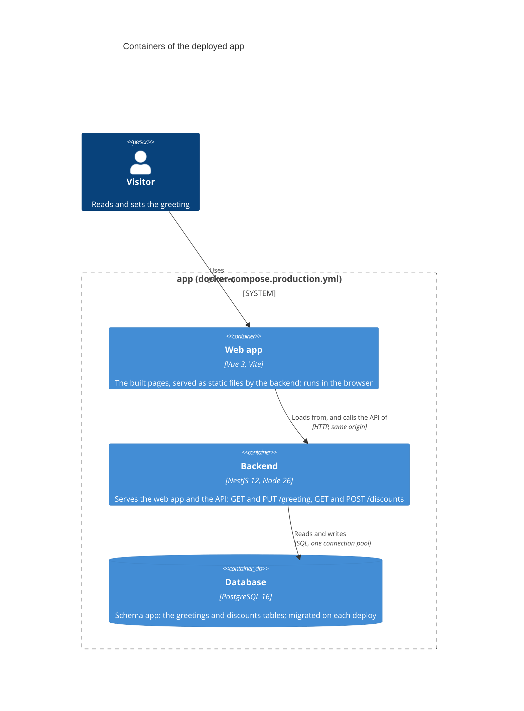
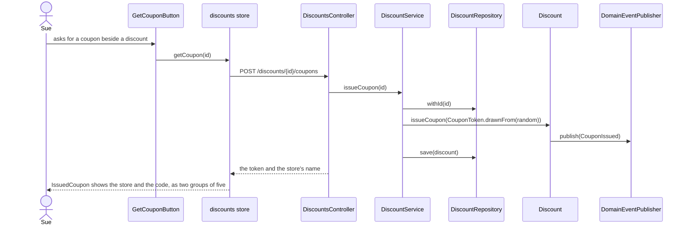
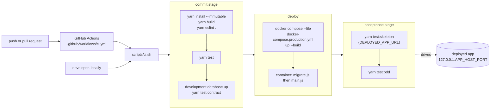

# Architecture: containers and deployment

C4 container and component diagrams of the deployed app, a sequence for publishing a discount, and the
pipeline that deploys it.

## Containers

The backend is one process: it serves the built web app (static files) and the API. The browser loads
the page from it, and the page calls the API on the same origin. The backend reads and writes
Postgres.



Port 3000 inside the container is published on `127.0.0.1:${APP_HOST_PORT:-8080}`. The container's
command runs `migrate.js` (the migrator) and then `main.js`; on SIGTERM the backend closes its pool and
exits.

## Components of the discounts context

The backend's one bounded context, `src/discounts/`. The domain (`application/domain/`) owns two ports,
the repository and the domain-event publisher; `infra/` holds their adapters, so the dependencies
point inward. The web app is one page, `#/`, which lists the published discounts and offers the form
to publish one; the walking skeleton's greeting page is `#/walking-skeleton` (hash routing, so a
reload of the statically served app keeps its route).

```mermaid
C4Component
  title Components of the discounts context

  Container_Boundary(web, "Web app (Vue 3)") {
    Component(view, "DiscountsView", "Vue view", "Loads the published discounts when the page opens")
    Component(list, "PublishedDiscounts", "Vue component", "The list of published discounts, or one short line saying nothing is published")
    Component(entry, "PublishedDiscount", "Vue component", "One entry: item, rate as written followed by %, store name and address, its hook when it has one, and its controls")
    Component(form, "PublishDiscountForm", "Vue component", "Publishes the typed discount and clears itself once published")
    Component(fields, "TypedDiscountFields", "Vue component", "Five captioned inputs: item, rate, store name, store address and the optional hook")
    Component(changeForm, "ChangeRateForm", "Vue component", "One per listed discount: a new rate and a button to change it")
    Component(couponButton, "GetCouponButton", "Vue component", "One per listed discount: asks for a coupon")
    Component(tillView, "TillView", "Vue view (#/till)", "The till page where Stephanie redeems a coupon")
    Component(redeemForm, "RedeemCouponForm", "Vue component", "Her store, picked from the stores that publish, and the coupon's code; redeems on submit")
    Component(storePicker, "StorePicker", "Vue component", "Picks one store, by name and address")
    Component(applies, "DiscountApplies", "Vue component", "Says the discount applies to the item redeemed")
    Component(issuedCoupon, "IssuedCoupon", "Vue component", "Shows the coupon just issued: the store to use it at and its code as two groups of five")
    Component(store, "discounts store", "Pinia", "publish(), load(), changeRate() and getCoupon() and redeemCoupon(); goes through RestApi, reloads the list after a rate change, holds the coupon just issued and the redemption, and derives the distinct stores from the published discounts")
  }

  Container_Boundary(backend, "Backend (NestJS)") {
    Component(controller, "DiscountsController", "NestJS controller", "POST /discounts answers 201 with Location; PATCH /discounts/:id answers 204; POST /discounts/:id/coupons answers the coupon; GET /discounts lists"')
    Component(redemptions, "RedemptionsController", "NestJS controller", "POST /redemptions answers 201 with the item; reads only the coupon's code")
    Component(parsedBy, "ParsedBy", "Nest pipe, zod", "Parses the request against the shared schema; a failure is a 400 requestRejection")
    Component(service, "DiscountService", "Application service", "publish(), changeRate(), issueCoupon(), redeemCoupon(code) and published()")
    Component(factory, "DiscountFactory", "Domain factory", "create() gives a new identity; reconstitute() rebuilds a kept discount")
    Component(discount, "Discount", "Aggregate", "Holds its id and DiscountDetails (item, rate, store name, store address, optional hook); publish() raises DiscountPublished, changeRate() raises DiscountRateChanged, issueCoupon() adds a coupon and raises CouponIssued, redeemCoupon(token) redeems it")
    Component(event, "DiscountPublished", "Domain event", "Carries the discount as published")
    Component(token, "CouponToken", "Value object", "Ten characters of Crockford base32: drawnFrom(random) for a new one, read(code) for a typed one (case, O, I, L and spacing normalised)")
    Component(issued, "IssuedCoupon", "Domain value", "A coupon token and the name of the store it is for")
    Component(coupon, "Coupon", "Entity in the aggregate", "A token and whether it was redeemed; owns single use; redeem() raises CouponRedeemed")
    Component(couponRedeemed, "CouponRedeemed", "Domain event", "Raised when a coupon is redeemed")
    Component(couponIssued, "CouponIssued", "Domain event", "Raised when a coupon is issued")
    Component(rateChanged, "DiscountRateChanged", "Domain event", "Carries the discount id and its new rate")
    Component(repositoryPort, "DiscountRepository", "Port", "save() (inserts or updates), all(), withId() and withCouponToken()")
    Component(publisherPort, "DomainEventPublisher", "Port", "publish(event)")
    Component(repository, "DiscountDrizzleRepository", "Adapter", "Keeps a discount in app.discounts and its coupons in app.coupons (token, redeemed), written and read with it; a null hook column is an absent hook")
    Component(publisher, "EventEmitterDomainEventPublisher", "Adapter", "Emits the event on the application's EventEmitter2")
  }

  ContainerDb(database, "Database", "PostgreSQL 16", "app.discounts, app.coupons")

  Rel(view, list, "Shows")
  Rel(view, form, "Shows")
  Rel(form, fields, "Asks through")
  Rel(list, entry, "Shows one per discount")
  Rel(entry, changeForm, "Shows")
  Rel(entry, couponButton, "Shows")
  Rel(view, issuedCoupon, "Shows the coupon just issued")
  Rel(couponButton, store, "getCoupon()")
  Rel(service, token, "Draws from the random source")
  Rel(discount, token, "Holds its coupons as")
  Rel(discount, issued, "Answers with")
  Rel(discount, couponIssued, "Raises")
  Rel(discount, coupon, "Holds its coupons as")
  Rel(coupon, couponRedeemed, "Raises")
  Rel(view, tillView, "Routes to")
  Rel(tillView, redeemForm, "Shows")
  Rel(tillView, applies, "Shows")
  Rel(redeemForm, storePicker, "Asks through")
  Rel(redeemForm, store, "redeemCoupon()")
  Rel(store, redemptions, "POST /redemptions", "JSON over HTTP")
  Rel(redemptions, service, "Calls")
  Rel(form, store, "publish()")
  Rel(changeForm, store, "changeRate()")
  Rel(view, store, "load()")
  Rel(store, controller, "POST, PATCH and GET /discounts", "JSON over HTTP")
  Rel(controller, parsedBy, "Parses the body with")
  Rel(controller, service, "Calls")
  Rel(service, factory, "Creates discounts with")
  Rel(factory, discount, "Builds")
  Rel(service, repositoryPort, "Saves and lists through")
  Rel(discount, event, "Raises")
  Rel(discount, rateChanged, "Raises")
  Rel(discount, publisherPort, "Publishes through")
  Rel(repository, repositoryPort, "Implements")
  Rel(publisher, publisherPort, "Implements")
  Rel(repository, database, "Reads and writes", "SQL")
```

### Publishing a discount

The discount is kept before it is announced: `DiscountPublished` is raised only once the repository
has saved it. The rate travels, is kept and is shown as text, exactly as Mike wrote it.

```mermaid
sequenceDiagram
  actor Mike
  participant Form as PublishDiscountForm
  participant Store as discounts store
  participant Controller as DiscountsController
  participant Service as DiscountService
  participant Discount
  participant Repository as DiscountRepository
  participant Events as DomainEventPublisher

  Mike->>Form: fills item, rate, store name, store address; submits
  Form->>Store: publish(discount)
  Store->>Controller: POST /discounts
  Controller->>Controller: ParsedBy checks the body (400 requestRejection when a field is missing or mistyped)
  Controller->>Service: publish(details)
  Service->>Discount: DiscountFactory.create(details)
  Service->>Repository: save(discount)
  Service->>Discount: publish()
  Discount->>Events: publish(DiscountPublished)
  Service-->>Controller: discount
  Controller-->>Store: 201, Location /discounts/{id}, the discount as JSON
  Form->>Form: clears its fields
```

### Changing a discount's rate

Anyone can change any discount's rate (ADR 0002). The request names the discount by its id and carries
the new rate as text. A change to a discount nobody published answers 204 and changes nothing.

```mermaid
sequenceDiagram
  actor Mike
  participant Form as ChangeRateForm
  participant Store as discounts store
  participant Controller as DiscountsController
  participant Service as DiscountService
  participant Repository as DiscountRepository
  participant Discount
  participant Events as DomainEventPublisher

  Mike->>Form: types a new rate beside a discount; submits
  Form->>Store: changeRate(id, change)
  Store->>Controller: PATCH /discounts/{id}
  Controller->>Controller: ParsedBy checks the body (400 requestRejection when the rate is missing or mistyped)
  Controller->>Service: changeRate(id, rate)
  Service->>Repository: withId(id)
  Service->>Discount: changeRate(rate)
  Discount->>Events: publish(DiscountRateChanged)
  Service->>Repository: save(discount)
  Controller-->>Store: 204
  Store->>Controller: GET /discounts
  Controller-->>Store: the discounts, with the new rate
```

### The hook

A discount may carry a hook: an optional free text saying why it is worth a look (the form asks
"Why it is worth a look (optional)"). In the domain, `DiscountDetails` has no `hook` key when there is
none; on the wire, `hook` is optional in the publish request and the response; in the database it is the
nullable `hook` column added by migration `0004` (its down drops the column and loses every hook). The
form leaves an empty hook out of the request, and the list shows a hook only when there is one, trimmed.

### Coupons

Coupons belong to the Discount aggregate: only the discount issues them, and it keeps no coupon
repository and no coupon port. `Discount.issueCoupon(token)` adds the token to the discount's coupons,
raises `CouponIssued` and answers with an `IssuedCoupon` (the token and the store's name), which the
controller maps through the shared `couponResponse` schema. `DiscountService.issueCoupon(id)` draws the
token with `CouponToken.drawnFrom(random)`; the random source is injected, and in production it is
`crypto.getRandomValues` (ADR 0004). The repository saves a discount's coupons with it, in the `coupons`
table (migration `0005`: a token that is unique, and a foreign key to the discount; its down drops the
table and loses every coupon issued).



### Redeeming a coupon

A coupon is an entity inside the Discount aggregate, since it carries a rule of its own: it can be
redeemed once (ADR 0005). `Coupon.redeem()` raises `CouponRedeemed`; `Discount.redeemCoupon(token)`
finds its coupon and redeems it, and answers with the item. The service reads the typed code with
`CouponToken.read` (any case; O read as 0, I and L as 1; a space or two groups), loads the discount
that issued it through the one Discount repository (`withCouponToken`), redeems, saves, and answers
`201 { item }` at `POST /redemptions`. The request also carries the till's store; the route reads only
the code, and the store is ignored until a refusal depends on it. Migration `0006` adds
`coupons.redeemed` (boolean, not null, default false; its down drops the column and loses which
coupons were redeemed). The till is the page `#/till`: it offers the stores that publish a discount,
derived from the published discounts, so Stephanie picks hers by name and address.

```mermaid
sequenceDiagram
  actor Stephanie
  participant Form as RedeemCouponForm
  participant Store as discounts store
  participant Controller as RedemptionsController
  participant Service as DiscountService
  participant Repository as DiscountRepository
  participant Discount
  participant Coupon
  participant Events as DomainEventPublisher

  Stephanie->>Form: picks her store, types the code; submits
  Form->>Store: redeemCoupon(request)
  Store->>Controller: POST /redemptions
  Controller->>Service: redeemCoupon(code)
  Service->>Service: CouponToken.read(code)
  Service->>Repository: withCouponToken(token)
  Service->>Discount: redeemCoupon(token)
  Discount->>Coupon: redeem()
  Coupon->>Events: publish(CouponRedeemed)
  Service->>Repository: save(discount)
  Controller-->>Store: 201, the item
  Store-->>Stephanie: DiscountApplies says the discount applies to the item
```

Every error answers with the one `requestRejection` schema in `@app/types/discounts`
(`statusCode`, `message`, optional `fields`); there is no exception filter.

## Deployment pipeline

`scripts/ci.sh` runs three stages. `.github/workflows/ci.yml` runs it on every push and pull request
on an `ubuntu-latest` runner; the same script runs locally from the repository root.


