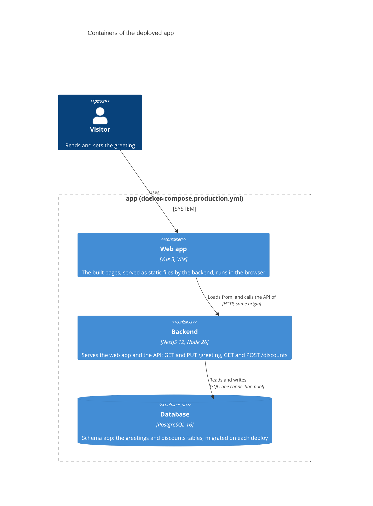
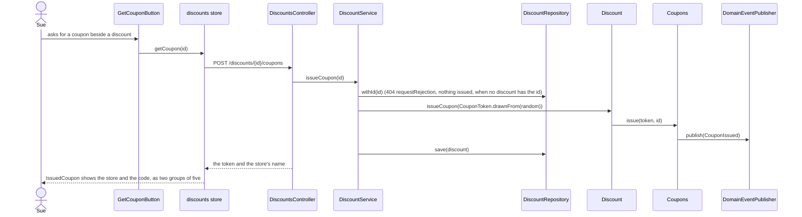
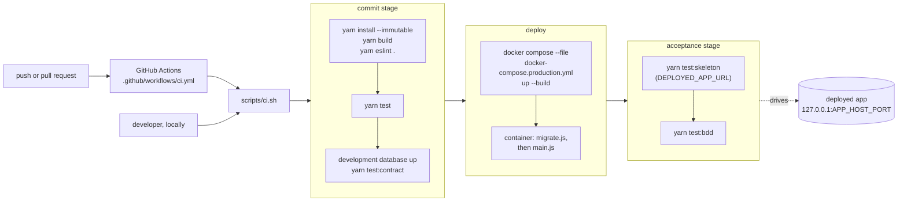

# Architecture: containers and deployment

C4 container and component diagrams of the deployed app, a sequence for publishing a discount, and the
pipeline that deploys it.

## Containers

The backend is one process: it serves the built web app (static files) and the API. The browser loads
the page from it, and the page calls the API on the same origin. The backend reads and writes
Postgres.



Port 3000 inside the container is published on `127.0.0.1:${APP_HOST_PORT:-8080}`. The container's
command runs `migrate.js` (the migrator) and then `main.js`; on SIGTERM the backend closes its pool and
exits.

## Components of the discounts context

The backend's one bounded context, `src/discounts/`. The domain (`application/domain/`) owns two ports,
the repository and the domain-event publisher; `infra/` holds their adapters, so the dependencies
point inward. The web app is one page, `#/`, which lists the published discounts and offers the form
to publish one; the walking skeleton's greeting page is `#/walking-skeleton` (hash routing, so a
reload of the statically served app keeps its route).

```mermaid
C4Component
  title Components of the discounts context

  Container_Boundary(web, "Web app (Vue 3)") {
    Component(view, "DiscountsView", "Vue view", "Loads the published discounts when the page opens")
    Component(list, "PublishedDiscounts", "Vue component", "The list of published discounts, or one short line saying nothing is published")
    Component(entry, "PublishedDiscount", "Vue component", "One entry: item, rate as written followed by %, store name and address, its hook when it has one, and its controls")
    Component(form, "PublishDiscountForm", "Vue component", "Publishes the typed discount and clears itself once published")
    Component(fields, "TypedDiscountFields", "Vue component", "Five captioned inputs: item, rate, store name, store address and the optional hook; each of the first four shows beside it what the publish answer tells of its piece")
    Component(changeForm, "ChangeRateForm", "Vue component", "One per listed discount: a new rate and a button to change it")
    Component(couponButton, "GetCouponButton", "Vue component", "One per listed discount: asks for a coupon")
    Component(tillView, "TillView", "Vue view (#/till)", "The till page where Stephanie redeems a coupon")
    Component(redeemForm, "RedeemCouponForm", "Vue component", "Her store, picked from the stores that publish, and the coupon's code; redeems on submit")
    Component(storePicker, "StorePicker", "Vue component", "Picks one store, by name and address, under a caption")
    Component(countView, "CountView", "Vue view (#/count)", "The count page: loads the published discounts, offers the count form and shows the counted discounts")
    Component(countForm, "CountDiscountedSalesForm", "Vue component", "The store, picked from the stores that publish, and a button to count its discounted sales")
    Component(counted, "CountedDiscounts", "Vue component", "One entry per discount counted: item, rate and the number of discounted sales")
    Component(answer, "TillAnswer", "Vue component", "Shows what the till's answer tells: the discount applies, the coupon has already been used, it is not valid, it is not for the store, or no store was said")
    Component(tillStore, "till store", "Pinia", "redeemCoupon() and noStoreSaid(); holds the one till answer, an object of till-answers.ts that tells its own caption")
    Component(applies, "DiscountApplies", "Vue component", "Says the discount applies to the item redeemed")
    Component(issuedCoupon, "IssuedCoupon", "Vue component", "Shows the coupon just issued: the store to use it at and its code as two groups of five")
    Component(store, "discounts store", "Pinia", "publish(), load(), changeRate() and getCoupon() and countDiscountedSales(); goes through RestApi, reloads the list after a rate change, holds the coupon just issued and the counted discounts, holds the one publish answer, and derives the distinct stores from the published discounts")
    Component(publishAnswers, "publish-answers.ts", "Frontend module", "The publish answer, one object per case (nothing told, rate not valid, pieces missing with their list), each telling the form-level caption and each piece's caption from the page's texts; publish-pieces.ts names the four pieces")
  }

  Container_Boundary(backend, "Backend (NestJS)") {
    Component(controller, "DiscountsController", "NestJS controller", "POST /discounts answers 201 with Location; PATCH /discounts/:id answers 204, or 404 for an id no discount has; POST /discounts/:id/coupons answers the coupon, or 404 for an id no discount has; GET /discounts lists")
    Component(storeCounts, "StoreCountsController", "NestJS controller", "POST /stores/counts answers 201 with each discount counted")
    Component(redemptions, "RedemptionsController", "NestJS controller", "POST /redemptions answers 201 with the item, 422 for a coupon of another store, 404 for a code nobody issued, 409 when it has already been used and 400 when the code or the store is missing or blank")
    Component(answeredRefusals, "answered-refusals.ts", "Infra module", "answeredWith(refusal class, its rejection) pairs a domain refusal with the requestRejection it is answered with; answerFrom(list) answers the first that matches and rethrows any other failure")
    Component(refusedPublish, "refused-publish.ts", "Infra module", "A list for answerFrom: pieces left out are a 400 with fields and missing, a rate not valid a 400 with fields ['rate']")
    Component(missingDiscount, "missing-discount.ts", "Infra module", "A list for answerFrom: NoSuchDiscountException is a 404 'There is no such discount'")
    Component(refusedRedemption, "refused-redemption.ts", "Infra module", "A list for answerFrom: a coupon of another store is a 422, a code nobody issued a 404 'No coupon has this code', a coupon already used a 409")
    Component(parsedBy, "ParsedBy", "Nest pipe, zod", "Parses the request against the shared schema; a failure is a 400 requestRejection, which lists in missing the fields the request leaves out")
    Component(service, "DiscountService", "Application service", "publish(), changeRate(), issueCoupon(), redeemCoupon(code, store), count(store) and published()")
    Component(changes, "DiscountChanges", "Application collaborator", "The unit of work: runs issuing, redeeming and counting through the repository's changing(work): load, tell, save in one transaction; finds the discount through one lookup builder taking the find and the refusal, theOneWithId (NoSuchDiscountException) or theOneThatIssued (NoCouponHasTheCodeException)")
    Component(factory, "DiscountFactory", "Domain factory", "create() gives a new identity; reconstitute() rebuilds a kept discount")
    Component(discount, "Discount", "Aggregate", "Holds its id and DiscountDetails (item, rate, store name, store address, optional hook); redeemCoupon(token, store) refuses a coupon of another store (Store.equals: name and address exactly) and raises CouponRedemptionRejected; publish(keep) asks its details whether it can be published: a discount with a piece left out or a rate that is not valid keeps nothing and raises DiscountPublicationRejected, otherwise it keeps the discount and raises DiscountPublished; changeRate() raises DiscountRateChanged; issueCoupon() and count() go through Coupons; redeemCoupon(token) redeems the coupon")
    Component(details, "DiscountDetails", "Value object", "whenPublishable(): first that item, rate, store name and store address are all present (empty or blank text is not), then the rate; raises PiecesMissingException with the pieces left out")
    Component(rate, "DiscountRate", "Value object", "The rule of a rate on publishing: above 0 and at most 100, at most one decimal")
    Component(publicationRejected, "DiscountPublicationRejected", "Domain event", "Raised when a discount is refused: the rate, the reason ('missing' or 'not valid') and the pieces refused")
    Component(event, "DiscountPublished", "Domain event", "Carries the discount as published")
    Component(token, "CouponToken", "Value object", "Ten characters of Crockford base32: drawnFrom(random) for a new one, read(code) for a typed one (case, O, I, L and spacing normalised; anything not written as a token, by length or alphabet, is refused with NoCouponHasTheCodeException)")
    Component(issued, "IssuedCoupon", "Domain value", "A coupon token and the name of the store it is for")
    Component(coupons, "Coupons", "Collection in the aggregate", "The discount's coupons: issues one and raises CouponIssued, finds by token and hands over the redemption, counts since the last count and raises DiscountedSalesCounted; publishes through the port; no repository")
    Component(coupon, "Coupon", "Entity in the aggregate", "A token, whether it was redeemed and whether it was counted; owns single use; redeem() raises CouponRedeemed, and a second redeem() raises CouponRedemptionRejected and refuses")
    Component(couponRedeemed, "CouponRedeemed", "Domain event", "Raised when a coupon is redeemed")
    Component(redemptionRejected, "CouponRedemptionRejected", "Domain event", "Raised when a coupon already used is redeemed: the discount id, the token and the reason")
    Component(salesCounted, "DiscountedSalesCounted", "Domain event", "Raised per discount counted: its id and its discounted sales")
    Component(couponIssued, "CouponIssued", "Domain event", "Raised when a coupon is issued")
    Component(rateChanged, "DiscountRateChanged", "Domain event", "Carries the discount id and its new rate")
    Component(repositoryPort, "DiscountRepository", "Port", "save() (inserts or updates), all(), withId(), withCouponToken(), ofStore(store) and changing(work), which runs a change in one transaction")
    Component(publisherPort, "DomainEventPublisher", "Port", "publish(event)")
    Component(repository, "DiscountDrizzleRepository", "Adapter", "Keeps a discount in app.discounts and its coupons in app.coupons (token, redeemed, counted), written and read with it; a null hook column is an absent hook")
    Component(publisher, "EventEmitterDomainEventPublisher", "Adapter", "Emits the event on the application's EventEmitter2")
  }

  ContainerDb(database, "Database", "PostgreSQL 16", "app.discounts, app.coupons")

  Rel(view, list, "Shows")
  Rel(view, form, "Shows")
  Rel(form, fields, "Asks through")
  Rel(list, entry, "Shows one per discount")
  Rel(entry, changeForm, "Shows")
  Rel(entry, couponButton, "Shows")
  Rel(view, issuedCoupon, "Shows the coupon just issued")
  Rel(couponButton, store, "getCoupon()")
  Rel(service, token, "Draws from the random source")
  Rel(discount, token, "Holds its coupons as")
  Rel(discount, issued, "Answers with")
  Rel(discount, coupon, "Holds its coupons as")
  Rel(coupon, couponRedeemed, "Raises")
  Rel(view, tillView, "Routes to")
  Rel(tillView, redeemForm, "Shows")
  Rel(tillView, answer, "Shows")
  Rel(answer, applies, "Shows when the coupon was redeemed")
  Rel(redeemForm, storePicker, "Asks through")
  Rel(redeemForm, tillStore, "redeemCoupon()")
  Rel(answer, tillStore, "Reads the answer of")
  Rel(discount, coupons, "Holds its coupons in")
  Rel(coupons, coupon, "Holds")
  Rel(coupons, couponIssued, "Raises")
  Rel(coupons, salesCounted, "Raises")
  Rel(coupons, publisherPort, "Publishes through")
  Rel(coupon, publisherPort, "Publishes through")
  Rel(discount, details, "Asks whether it can be published")
  Rel(controller, refusedPublish, "Answers a refused publish through")
  Rel(controller, missingDiscount, "Answers a missing discount through")
  Rel(redemptions, refusedRedemption, "Answers a refused redemption through")
  Rel(refusedPublish, answeredRefusals, "Is a list for")
  Rel(missingDiscount, answeredRefusals, "Is a list for")
  Rel(refusedRedemption, answeredRefusals, "Is a list for")
  Rel(store, publishAnswers, "Holds the answer of")
  Rel(fields, publishAnswers, "Asks what the answer tells of each piece")
  Rel(store, redemptions, "POST /redemptions", "JSON over HTTP")
  Rel(redemptions, service, "Calls")
  Rel(view, countView, "Routes to")
  Rel(countView, countForm, "Shows")
  Rel(countView, counted, "Shows")
  Rel(countForm, storePicker, "Asks through")
  Rel(countForm, store, "countDiscountedSales()")
  Rel(store, storeCounts, "POST /stores/counts", "JSON over HTTP")
  Rel(storeCounts, service, "Calls")
  Rel(service, changes, "Changes discounts through")
  Rel(coupon, redemptionRejected, "Raises")
  Rel(form, store, "publish()")
  Rel(changeForm, store, "changeRate()")
  Rel(view, store, "load()")
  Rel(store, controller, "POST, PATCH and GET /discounts", "JSON over HTTP")
  Rel(controller, parsedBy, "Parses the body with")
  Rel(controller, service, "Calls")
  Rel(service, factory, "Creates discounts with")
  Rel(factory, discount, "Builds")
  Rel(service, repositoryPort, "Saves and lists through")
  Rel(discount, event, "Raises")
  Rel(discount, rate, "Checks its rate with")
  Rel(discount, publicationRejected, "Raises")
  Rel(discount, rateChanged, "Raises")
  Rel(discount, publisherPort, "Publishes through")
  Rel(repository, repositoryPort, "Implements")
  Rel(publisher, publisherPort, "Implements")
  Rel(repository, database, "Reads and writes", "SQL")
```



### Publishing a discount

The discount is kept before it is announced: `DiscountPublished` is raised only once the repository
has saved it. The rate travels, is kept and is shown as text, exactly as Mike wrote it.

```mermaid
sequenceDiagram
  actor Mike
  participant Form as PublishDiscountForm
  participant Store as discounts store
  participant Controller as DiscountsController
  participant Service as DiscountService
  participant Discount
  participant Repository as DiscountRepository
  participant Events as DomainEventPublisher

  Mike->>Form: fills item, rate, store name, store address; submits
  Form->>Store: publish(discount)
  Store->>Controller: POST /discounts
  Controller->>Controller: ParsedBy checks the body (400 requestRejection when a field is left out, listed in missing, or mistyped)
  Controller->>Service: publish(details)
  Service->>Discount: DiscountFactory.create(details)
  Service->>Discount: publish(keep)
  Discount->>Discount: DiscountDetails checks the pieces, then DiscountRate the rate (400, nothing kept, DiscountPublicationRejected raised, when a piece is blank or the rate is not valid)
  Discount->>Repository: keep(discount) saves it
  Discount->>Events: publish(DiscountPublished)
  Service-->>Controller: discount
  Controller-->>Store: 201, Location /discounts/{id}, the discount as JSON
  Form->>Form: clears its fields
```

### Leaving pieces out

A discount needs an item, a rate, a store name and a store address. A request that leaves a field out of
the body is refused by `ParsedBy` before any rule runs: `400` with the field in `fields` and in `missing`,
and no event. A field that is there but of the wrong JSON type is in `fields` only, not in `missing`.
A piece that is there but empty or blank is refused by `Discount` itself: `DiscountDetails.whenPublishable`
checks that every piece is present, and only then the rate, so a rate is never judged while a piece is
missing. The discount keeps nothing, raises `DiscountPublicationRejected` with the reason `missing` and
the pieces, and throws `PiecesMissingException`; `infra/refused-publish.ts` answers it with the same
shape, `400`, the message "Missing fields", the pieces in `fields` and in `missing`. A rate not valid
stays a `400` with `fields: ['rate']` and nothing in `missing`; any other failure is not a refusal and
answers `500`. The schema is `requestRejection` in `@app/types/request-rejection`, with the optional
`missing` list.

In the web app, `FetchRestApi` turns a `400` into a `BadRequestException` carrying `missing` and `fields`
(`@app/types/rest-api-refusals`). The discounts store holds one publish answer, an object of
`discounts/publish-answers.ts` (nothing told, the rate not valid, pieces missing with their list): the
answer to a `400` lists the missing pieces first, then the rate; a successful publish resets it. Each
answer tells the form-level caption and each piece's caption (`publish-pieces.ts` names the four pieces)
from the page's texts, and `TypedDiscountFields` hands each caption to `CaptionedInput` as `told`, which
shows it as a status beside its field, outside the field's label. Mike is told, beside each field, which
pieces are missing; a failure that is not a `400` is rethrown.

### The rate's rule

A rate is checked when a discount is published, and only then: a rate already kept is never checked
again, and changing a rate has no rule yet. `DiscountRate` holds the rule: the rate is written as
digits (no sign, no leading zero) with at most one decimal after a point or a comma, the whole value
and nothing around it, and it is above 0 and at most 100. `Discount.publish(keep)` asks the rate; when it
is not valid the discount keeps nothing, raises `DiscountPublicationRejected` (the rate and the reason)
and refuses, and `POST /discounts` answers `400` with `fields: ['rate']` in the one error schema. The
rate stays text in the discount and in the database, exactly as written. The form shows "The rate must
be above 0 % and at most 100 %, with at most one decimal." and lists nothing new.

### Changing a discount's rate

Anyone can change any discount's rate (ADR 0002). The request names the discount by its id and carries
the new rate as text. A change to a discount nobody published changes nothing and answers `404` with the one error schema: `DiscountService.changeRate` throws `NoSuchDiscountException` and `infra/missing-discount.ts` answers it.

```mermaid
sequenceDiagram
  actor Mike
  participant Form as ChangeRateForm
  participant Store as discounts store
  participant Controller as DiscountsController
  participant Service as DiscountService
  participant Repository as DiscountRepository
  participant Discount
  participant Events as DomainEventPublisher

  Mike->>Form: types a new rate beside a discount; submits
  Form->>Store: changeRate(id, change)
  Store->>Controller: PATCH /discounts/{id}
  Controller->>Controller: ParsedBy checks the body (400 requestRejection when the rate is missing or mistyped)
  Controller->>Service: changeRate(id, rate)
  Service->>Repository: withId(id)
  Service->>Service: NoSuchDiscountException when no discount has the id (404 requestRejection, nothing changed)
  Service->>Discount: changeRate(rate)
  Discount->>Events: publish(DiscountRateChanged)
  Service->>Repository: save(discount)
  Controller-->>Store: 204
  Store->>Controller: GET /discounts
  Controller-->>Store: the discounts, with the new rate
```

### The hook

A discount may carry a hook: an optional free text saying why it is worth a look (the form asks
"Why it is worth a look (optional)"). In the domain, `DiscountDetails` has no `hook` key when there is
none; on the wire, `hook` is optional in the publish request and the response; in the database it is the
nullable `hook` column added by migration `0004` (its down drops the column and loses every hook). The
form leaves an empty hook out of the request, and the list shows a hook only when there is one, trimmed.

### Coupons

Coupons belong to the Discount aggregate: only the discount issues them, and it keeps no coupon
repository and no coupon port. `Discount.issueCoupon(token)` adds the token to the discount's coupons,
raises `CouponIssued` (through `Coupons`, which owns issuing) and answers with an `IssuedCoupon` (the token and the store's name), which the
controller maps through the shared `couponResponse` schema. `DiscountService.issueCoupon(id)` draws the
token with `CouponToken.drawnFrom(random)`; the random source is injected, and in production it is
`crypto.getRandomValues` (ADR 0004). The repository saves a discount's coupons with it, in the `coupons`
table (migration `0005`: a token that is unique, and a foreign key to the discount; its down drops the
table and loses every coupon issued). A coupon asked for an id no discount has issues nothing and
answers `404` with the one error schema (`NoSuchDiscountException`, answered by `infra/missing-discount.ts`).



### Redeeming a coupon

A coupon is an entity inside the Discount aggregate, since it carries a rule of its own: it can be
redeemed once (ADR 0005). `Coupon.redeem()` raises `CouponRedeemed`; `Discount.redeemCoupon(token, store)`
refuses a coupon of another store, finds its coupon through `Coupons` and redeems it, and answers with the item. The service reads the typed code with
`CouponToken.read` (any case; O read as 0, I and L as 1; a space or two groups), loads the discount
that issued it through the one Discount repository (`withCouponToken`), redeems, saves, and answers
`201 { item }` at `POST /redemptions`. The request carries the code and the till's store (code, name and
address, none missing nor blank: a `400` otherwise); the discount compares it with its own store, exactly
(`Store.equals`), and a coupon of another store is refused with `422` (below). Migration `0006` adds
`coupons.redeemed` (boolean, not null, default false; its down drops the column and loses which
coupons were redeemed). The till is the page `#/till`: it offers the stores that publish a discount,
derived from the published discounts, so Stephanie picks hers by name and address.

```mermaid
sequenceDiagram
  actor Stephanie
  participant Form as RedeemCouponForm
  participant Store as till store
  participant Controller as RedemptionsController
  participant Service as DiscountService
  participant Repository as DiscountRepository
  participant Discount
  participant Coupon
  participant Events as DomainEventPublisher

  Stephanie->>Form: picks her store, types the code; submits
  Form->>Store: redeemCoupon(request)
  Store->>Controller: POST /redemptions
  Controller->>Service: redeemCoupon(code, store)
  Service->>Service: CouponToken.read(code) (404 'No coupon has this code' when it is not written as a token)
  Service->>Repository: withCouponToken(token) (the same 404 when no discount issued it)
  Service->>Discount: redeemCoupon(token, store)
  Discount->>Discount: Store.equals(its own store) (422, CouponRedemptionRejected 'not for this store', when it differs)
  Discount->>Coupon: redeem() through Coupons
  Coupon->>Events: publish(CouponRedeemed)
  Service->>Repository: save(discount)
  Controller-->>Store: 201, the item
  Store-->>Stephanie: TillAnswer tells that the discount applies to the item
```

### Counting the discounted sales

A coupon holds whether it was redeemed and whether it was counted. `Discount.count()` has `Coupons` count the
coupons redeemed since the last count, mark them counted and raise `DiscountedSalesCounted` for the
discount; it answers with the discount's id, item, rate and number of sales. `DiscountService.count(store)`
runs it through `DiscountChanges`, the unit of work every use case shares: it loads a discount through
the repository port, tells it the change and saves it, one discount per save (ADR 0006). For a count the
discounts come from `DiscountRepository.ofStore`, which matches the store's name and address. Today the
count is applied to the first discount `ofStore` finds. `POST /stores/counts` answers `201` with the
discounts counted; the answer holds no coupon token. Migration `0007` adds `coupons.counted` (boolean,
not null, default false; its down drops the column and loses which coupons were counted). The count page
is `#/count`: Rodrigo picks his store, from the stores that publish, and counts.

```mermaid
sequenceDiagram
  actor Rodrigo
  participant Form as CountDiscountedSalesForm
  participant Store as discounts store
  participant Controller as StoreCountsController
  participant Service as DiscountService
  participant Changes as DiscountChanges
  participant Repository as DiscountRepository
  participant Discount
  participant Coupons
  participant Events as DomainEventPublisher

  Rodrigo->>Form: picks his store; counts its discounted sales
  Form->>Store: countDiscountedSales(store)
  Store->>Controller: POST /stores/counts
  Controller->>Service: count(store)
  Service->>Changes: toEachOfTheStore(store, count)
  Changes->>Repository: ofStore(store)
  Changes->>Discount: count()
  Discount->>Coupons: countSinceTheLastCount(id)
  Coupons->>Events: publish(DiscountedSalesCounted)
  Changes->>Repository: save(discount)
  Controller-->>Store: 201, the discounts counted
  Store-->>Rodrigo: CountedDiscounts shows each discount's sales
```

### Where the aggregate splits

`Discount` decides: it runs every rule (the pieces and the rate, the store, what a count restarts) and
raises the events of what it owns: `DiscountPublished`, `DiscountPublicationRejected`,
`DiscountRateChanged` and, for the store rule, `CouponRedemptionRejected`. Each entity raises the events
of what it owns, through the event-publisher port (ADR 0009). `Coupons`, a collection inside the
aggregate with no port and no repository, reached only through `Discount` and persisted with it, owns
issuing, finding a coupon by token and handing it the redemption, counting what was redeemed since the
last count, and `toJSON`: it raises `CouponIssued` and `DiscountedSalesCounted`, one per discount, each
carrying the discount's id. `Coupon` raises `CouponRedeemed` and its single-use
`CouponRedemptionRejected`. There is no class that builds or publishes the events for the others (ADR
0008's `DiscountEvents` is gone).

### Single use, and one change at a time

A coupon is redeemed once. `Coupon.redeem` on a coupon already redeemed (counted or not) raises
`CouponRedemptionRejected` with the discount's id, the token and the reason, raises no second
`CouponRedeemed`, and refuses; `POST /redemptions` answers `409` with a `requestRejection` body, and the
till shows "This coupon has already been used.", not "the discount applies".

A coupon redeemed at another store than its discount's is not redeemed: `Discount` raises
`CouponRedemptionRejected` with the reason 'not for this store' and refuses, `POST /redemptions` answers
`422`, and the till shows "This coupon is not for your store." A used coupon tried at another store is
refused as not for that store. The web app's `FetchRestApi` turns a refused answer into the refusal for its
status, found by `theRefusalFor(status)` in `@app/types/rest-api-refusals`: each refusal of its own
(`UnprocessableContentException` for `422`, `NotFoundException` for `404`) names the status it is thrown
for in a static `status`, and any other status is a plain `RestApiException`. The till store pairs each
refusal with the answer it gets in the list `answersToRefusals` (`422`: not for this store; `404`: not
valid), and any other failure is told as already used. It holds one answer at a time, an object of
`till-answers.ts` (the discount applies with its item, already used, not valid, not for this store, no
store said), each telling its own caption from the page's texts; `TillAnswer.vue` shows it.

A code nobody issued is not a discount missing, and is refused as a family of its own (ADR 0010).
`CouponToken.read` refuses a code that is not written as a token (wrong length or alphabet, after O, I and
L are read as digits) and `DiscountChanges.theOneThatIssued` refuses a code no discount holds, both with
`NoCouponHasTheCodeException`; nothing is changed and no event is raised. `POST /redemptions` answers
`404` with the message "No coupon has this code", a malformed code and a well-formed one alike. A blank
code is a `400` from `ParsedBy`. The `409` is answered only for `CouponAlreadyUsedException`; a failure that
no list knows is not a refusal and answers `500`. The till shows "This coupon is not valid." and does not
say the discount applies, and its code input is `required`.

Each family of refusals is answered by a list in `infra/`, not by a chain of `instanceof`:
`answered-refusals.ts` holds `answeredWith(refusal class, its rejection)`, which pairs a refusal with the
`requestRejection` it is answered with, and `answerFrom(list)`, which answers with the first that matches
and rethrows anything else. `refused-publish.ts`, `missing-discount.ts` and `refused-redemption.ts` are each
such a list. In the application layer, `DiscountChanges` finds a discount through one builder taking the
find and the refusal: `theOneWithId` (exported; `changeRate` outside `changing` uses it too, refusing with
`NoSuchDiscountException`) and `theOneThatIssued` (`NoCouponHasTheCodeException`).

Issuing, redeeming and counting each run through `DiscountRepository.changing(work)`: the Drizzle
adapter runs the work in one database transaction with a transaction-bound repository, and `withId`
locks the discount's row (`SELECT … FOR UPDATE`) before it reads the coupons (ADR 0007). Concurrent
changes to one discount are therefore serialised: a redemption is never lost or counted twice, a
coupon is never counted in two counts, and nobody is shown a refusal for a change made since they
looked. `changeRate` runs outside `changing` and keeps last-write-wins on the rate.

Every error answers with the one `requestRejection` schema in `@app/types/request-rejection`
(`statusCode`, `message`, optional `fields`, optional `missing`); there is no exception filter.

## Deployment pipeline

`scripts/ci.sh` runs three stages. `.github/workflows/ci.yml` runs it on every push and pull request
on an `ubuntu-latest` runner; the same script runs locally from the repository root.


