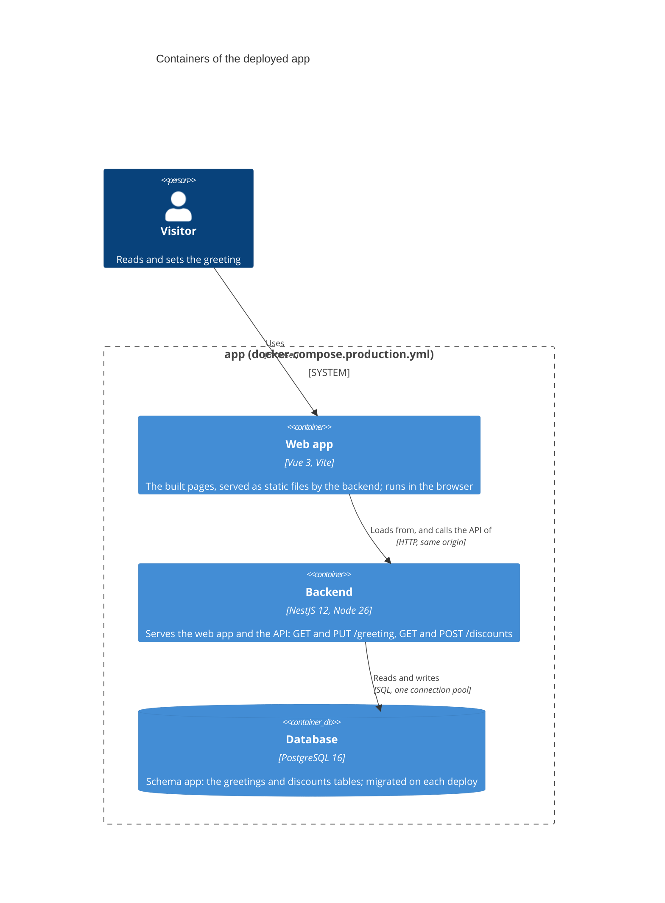
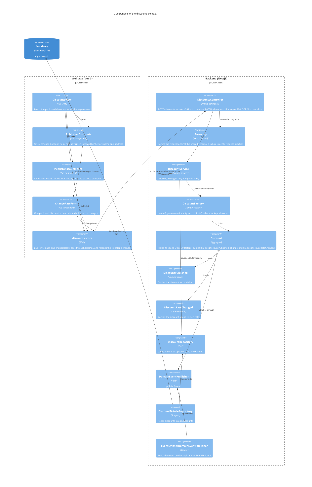
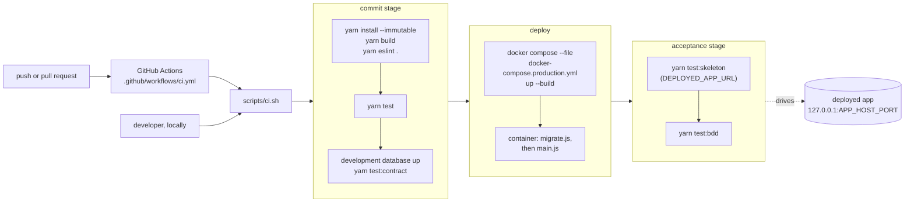

# Architecture: containers and deployment

C4 container and component diagrams of the deployed app, a sequence for publishing a discount, and the
pipeline that deploys it.

## Containers

The backend is one process: it serves the built web app (static files) and the API. The browser loads
the page from it, and the page calls the API on the same origin. The backend reads and writes
Postgres.



Port 3000 inside the container is published on `127.0.0.1:${APP_HOST_PORT:-8080}`. The container's
command runs `migrate.js` (the migrator) and then `main.js`; on SIGTERM the backend closes its pool and
exits.

## Components of the discounts context

The backend's one bounded context, `src/discounts/`. The domain (`application/domain/`) owns two ports,
the repository and the domain-event publisher; `infra/` holds their adapters, so the dependencies
point inward. The web app is one page, `#/`, which lists the published discounts and offers the form
to publish one; the walking skeleton's greeting page is `#/walking-skeleton` (hash routing, so a
reload of the statically served app keeps its route).



### Publishing a discount

The discount is kept before it is announced: `DiscountPublished` is raised only once the repository
has saved it. The rate travels, is kept and is shown as text, exactly as Mike wrote it.

```mermaid
sequenceDiagram
  actor Mike
  participant Form as PublishDiscountForm
  participant Store as discounts store
  participant Controller as DiscountsController
  participant Service as DiscountService
  participant Discount
  participant Repository as DiscountRepository
  participant Events as DomainEventPublisher

  Mike->>Form: fills item, rate, store name, store address; submits
  Form->>Store: publish(discount)
  Store->>Controller: POST /discounts
  Controller->>Controller: ParsedBy checks the body (400 requestRejection when a field is missing or mistyped)
  Controller->>Service: publish(details)
  Service->>Discount: DiscountFactory.create(details)
  Service->>Repository: save(discount)
  Service->>Discount: publish()
  Discount->>Events: publish(DiscountPublished)
  Service-->>Controller: discount
  Controller-->>Store: 201, Location /discounts/{id}, the discount as JSON
  Form->>Form: clears its fields
```

### Changing a discount's rate

Anyone can change any discount's rate (ADR 0002). The request names the discount by its id and carries
the new rate as text. A change to a discount nobody published answers 204 and changes nothing.

```mermaid
sequenceDiagram
  actor Mike
  participant Form as ChangeRateForm
  participant Store as discounts store
  participant Controller as DiscountsController
  participant Service as DiscountService
  participant Repository as DiscountRepository
  participant Discount
  participant Events as DomainEventPublisher

  Mike->>Form: types a new rate beside a discount; submits
  Form->>Store: changeRate(id, change)
  Store->>Controller: PATCH /discounts/{id}
  Controller->>Controller: ParsedBy checks the body (400 requestRejection when the rate is missing or mistyped)
  Controller->>Service: changeRate(id, rate)
  Service->>Repository: withId(id)
  Service->>Discount: changeRate(rate)
  Discount->>Events: publish(DiscountRateChanged)
  Service->>Repository: save(discount)
  Controller-->>Store: 204
  Store->>Controller: GET /discounts
  Controller-->>Store: the discounts, with the new rate
```

Every error answers with the one `requestRejection` schema in `@app/types/discounts`
(`statusCode`, `message`, optional `fields`); there is no exception filter.

## Deployment pipeline

`scripts/ci.sh` runs three stages. `.github/workflows/ci.yml` runs it on every push and pull request
on an `ubuntu-latest` runner; the same script runs locally from the repository root.


